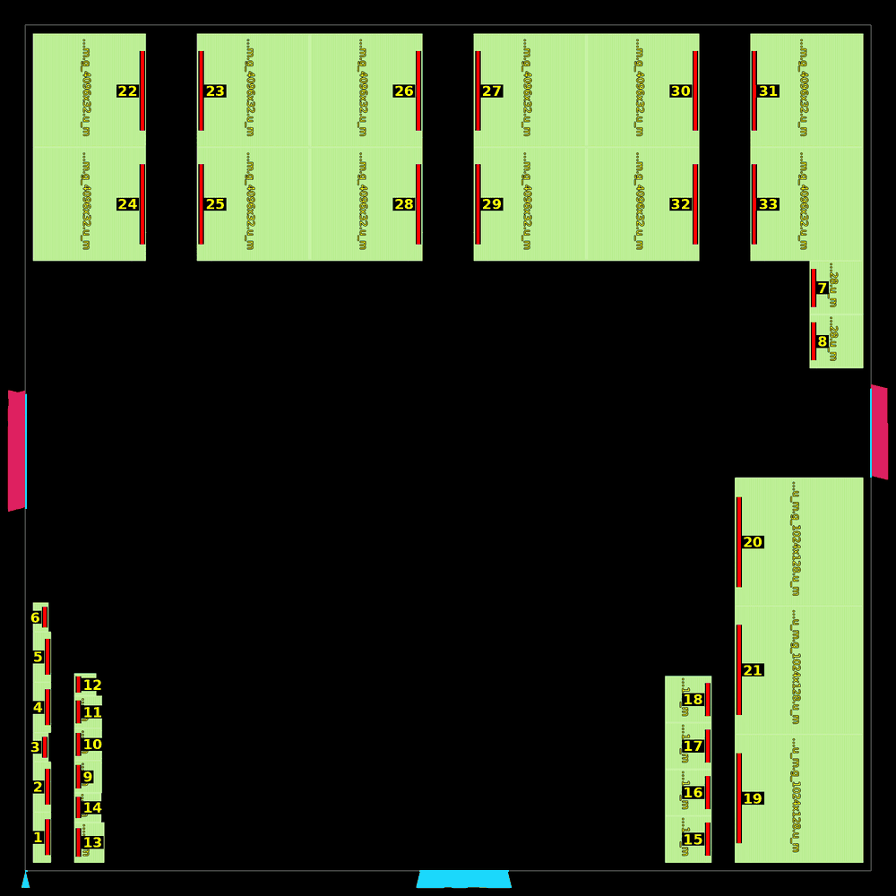
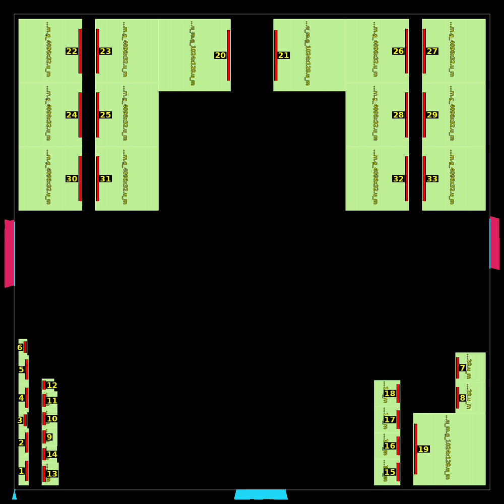
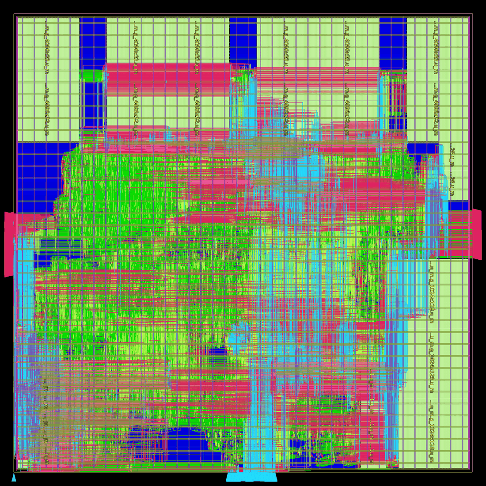

# The ASIC timing loop: RTL and physical design together

A loop for closing an ASIC block's clock the way a real design team does it: change the RTL, run
synthesis and the whole physical design (floorplan, macro placement, placement, CTS, routing, with
timing repair), read the routed timing, find what limits it, change the RTL again. Placement-stage
estimates or synthesis-only timing are not the feedback: only the routed design says where the
delay is (on this block half or more of the worst paths' delay is repeaters, which synthesis
never sees).
Every RTL change is verified bit-exact before it costs a P&R run.

Section 1 is the loop, section 2 a prompt that hands it to a coding agent (any project, any
node), section 3 the loop run on openTPU's `nangate45-small` block: **3.0 ns closed** (0 setup, 0
hold violators, 0 DRC after routing).

## 1. The loop

**Iteration 0 (the baseline, no RTL change).**
1. Synthesize the block's ASIC RTL with Yosys, the SRAMs as hard macros (black boxes in synthesis,
   LEF / Liberty views in P&R; check the macro count after synthesis: a RAM that was inferred
   into flip-flops instead is the classic silent failure).
2. Floorplan at a fixed utilization and aspect ratio; place the I/O pins.
3. Plan **two or more different macro placements** (different topologies, not perturbations),
   and gate each with a placement checker (overlaps, halos, pin sides facing the logic, channels
   between facing pins, the core edges) with a fixed retry budget.
4. Run placement, CTS and routing on every candidate that passes, **with timing repair** (setup
   and hold repair after CTS and after global routing). Never skip the repair: unrepaired
   numbers say nothing about the RTL.
5. Report the routed timing: WNS / TNS / violating endpoints overall and per path group
   (reg2reg, in2reg, reg2out, in2out), hold, DRC, area, power, and the worst paths of every group
   cell by cell with fanout, capacitance and slew.

**Iteration N.**
1. **Read the critical paths**: for the worst paths of each group, split the delay into logic and
   repeaters (buffers inserted by repair), name the RTL signals at the start, middle and end, and
   find the RTL that makes the path (a wide fanout behind an arbiter, an unregistered port, a
   long carry chain, a placement that puts two communicating units far apart).
2. **Decide the change**: an RTL change (pipeline a port, register a grant, precompute a select a
   cycle early, retime) or a physical one (macro placement, pin placement), and predict its
   effect. Prefer changes that remove a path class over ones that shave a path.
3. **Verify the RTL strictly** before any synthesis: the project's full RTL regression, bit-exact
   against its reference model, with the change active in every simulated build (check the
   simulator's parameters, not just the test outcome). The result must equal the baseline's
   (the same passes, the same known failures). Back-pressure and ordering changes need tests with
   random stalls.
4. **Re-run synthesis and P&R** with everything else held: the same die, the same macro
   placement, the same constraints, the same scripts, so the difference is the RTL's.
5. **Compare** with the previous iteration (the table of step 5 above), record it, and go back to 1.

**Rules.** Change one thing per iteration. Keep every iteration's netlist, databases, reports and
diff. Run the same STA views every time (see the virtual-clock note in section 4). Limit parallel
P&R runs to what the machine can hold (a ~0.5 M-cell block needs ~25 GB and 2-3 h per run).

## 2. The prompt

Fill the `<...>` fields and give it to the agent. `<SKILLS>` is a set of P&R skills: the
NanGate45 ones used here are [OpenLayout `skills/skills_Nangate45`](https://github.com/fenggev56/OpenLayout/tree/main/skills/skills_Nangate45)
(`1.macro_place/SKILL_planner.md` and `SKILL_checker.md`, `2.detail_place`,
`3.post_detail_placement`: OpenROAD templates for placement, CTS and routing with repair).

```text
Close the clock of the ASIC block <TOP> (RTL in <REPO>, ASIC configuration <CONFIG>) at
<CLOCK_NS> ns with an optimization loop that combines RTL and physical design.

The loop: generate the routed timing report, check the critical paths, read the logic behind
them, think about whether and how the RTL (or the macro placement) can be changed to improve the
timing, make the change, and run synthesis and the whole physical design again to get detailed
timing feedback. That is the loop of real-world design: no placement-only or synthesis-only
proxies.

Verification must be strict: before synthesizing any RTL change, run <REGRESSION> (bit-exact
against <REFERENCE_MODEL>) with the change active, and require exactly the baseline's result.
Make the change a parameter if the regression does not simulate the ASIC top, and confirm from
the simulator's build parameters that every build had it on.

Synthesis: Yosys on the ASIC RTL, with the memory macros (black boxes, their count checked after
synthesis); template script <SYN_TEMPLATE>; node <PLATFORM_DIR> (liberty, LEF, tech LEF).

P&R: use the skills in <SKILLS>.
- Floorplan: utilization <UTIL>%, aspect ratio <ASPECT>.
- Generate <N_CANDIDATES> different macro-placement candidates with <SKILLS>/1.macro_place/
  SKILL_planner.md, and gate each with <SKILLS>/1.macro_place/SKILL_checker.md (budget
  <CHECK_BUDGET> checks per candidate).
- Run detailed placement, CTS and routing from the skills' templates. Do not skip timing repair.
- Report per candidate: setup WNS / TNS / violating endpoints overall and per path group
  (reg2reg, in2reg, reg2out, in2out), hold, DRC, area, power, and the worst paths with fanout,
  cap and slew, split into logic and repeater delay.

Loop iterations: <N_ITER> (0: the initial results only). In later iterations keep the die, the
best candidate's macro placement and the constraints, so only the RTL differs.
At most <MAX_PARALLEL_PNR> P&R runs at once. Save results, scripts and a README with the
comparison table in <RESULTS_DIR>.
```

## 3. openTPU `nangate45-small` at 3.0 ns

The block: `rtl/asic/otpu_asic_top.sv` at `targets/nangate45-small.toml` (D 32, MCOLS 2, 4 lanes,
banked TMEM, 33 SRAM macros from `tools/asic/fakeram.py`), 3.0 ns, the ports with 20% of the period
outside, Yosys 0.69 + yosys-slang, OpenROAD v2.0-17598, NanGate45; utilization 60%, aspect 1 (die
2160 um square).

**Iteration 0** (main `ffe997e`): two macro placements, both through the checker on the first
try. *candA* puts TMEM's 12 macros in a 2 x 6 band on the pin-free top edge, one copy around each
of three pin-to-pin channels, the DMA's line buffers under the band next to port B, the
quantizer's RAMs in the bottom-right corner, ACT RAM and MXU FIFOs facing each other bottom
left. *candB* puts TMEM in two corner blocks.

| candA: top band | candB: two top corners |
|---|---|
|  |  |

The macros as the checker saw them (`macro_pin_side`): red, each macro's pin edge; the numbers,
the macros; on the die's edges, the I/O pin groups (left: port A and the SW writes; right: port B
data; bottom: controls and the clock).

| routed, 3.0 ns | candA | candB |
|---|---|---|
| setup WNS / TNS / violators | -0.698 / -12.84 / 21 | -0.753 / -968.29 / 4170 |
| of which reg2reg | 0 (worst +0.053) | 4149 (worst -0.535) |
| of which reg2out (`sw_wdata`, `sw_req`) | 21 (worst -0.698) | 21 |
| hold WNS / violators, DRC | -0.006 / 1, 1 | -0.034 / 16, 1 |

candB loses on placement: the DMA's state crosses the die to every TMEM copy (2.11 ns of
repeaters on the worst path). candA's register paths meet; its 21 violators are the SW port.

**The critical path.** `sw_wdata` came from the quantizer's QST scale-row word (`otpu_quant`
`dword`: the group maxes through `dval`, ~1.3 ns of adders and compares) and `sw_req` from the TMEM
grant, both leaving the block without a register; the ports' 0.6 ns outside budget does the
rest.

**Iteration 1: `SW_REG`.** `otpu_slice` puts the SW port's outputs (`sw_req / sw_addr / sw_wdata
/ sw_be`) behind flip-flops. The register takes a write when it is empty or draining (the
arbiters see `sw_rdy_i = !sw_v || sw_rdy`: one write per cycle still goes out, and the
quantizer's grant is withheld exactly when the port cannot take a write); a write held there counts
as one the DRAM has not taken (`wr_idle_i = wr_idle && !sw_v`), so a QST, a HALT CHAIN and a
WAITW timeout end only once the DRAM has it; only the loader's reset clears it. This iteration
ran it as a parameter (`SW_REG`: a target's `[uarch] SW_REG = true`, on in `nangate45-small`
only; `OTPU_SW_REG=1` in simulation). It is now unconditional: every target builds it (the card's
FPGA build too, where the quantizer -> the DRAM adapter's SW gather registers had been near
critical: -0.260 ns in an r2 candidate, -0.092 ns in an r2.1 one, and r2.1's E3 build's worst
endpoint at +0.007 ns), every simulation runs it, and
the parameter is gone. `sw_req` is the register's valid bit, so outside the block every write is
taken once `wr_idle && !sw_req` (`otpu_board`'s STATUS WR_IDLE and run start read that).

Verified with it on: `OTPU_TARGET=nangate45-small OTPU_UARCH=board pytest tests/test_rtl.py`, 131
passed and the 2 known failures of main (`test_additive_mask_block_rtl`: the ISA simulator's
"QACT out of ACT RAM bounds" on this target's ACT RAM), all 19 simulator builds with
`-GSW_REG=1`, three of them on the AXI memory path with random stalls (the SW write tests: RMW
fuzz, partial-beat order, write gather, beside DMA writes); `tests/test_quant_rtl.py` 30 passed.

| candA, routed, 3.0 ns | iteration 0 | iteration 1 (`SW_REG`) |
|---|---|---|
| setup WNS / TNS / violators | -0.698 / -12.84 / 21 | **+0.001 / 0 / 0** |
| worst reg2out | -0.698 (`sw_wdata[25]`) | +0.36 (`b_wmask[0]`) |
| hold WNS / violators | -0.006 / 1 | +0.039 / 0 |
| DRC | 1 | 0 |
| flip-flops / std-cell area / power | 106,887 / 2,823,324 um² / 0.691 W | 106,954 / 2,822,395 um² / 0.680 W |



candA after routing, iteration 1. The same die, macro placement, constraints and scripts; P&R 2 h 12 min, 25 GB. The earlier
implementation of this block (an older RTL, before main's MXU and quantizer rewrites, and other
P&R scripts) closed at 3.3 ns and missed 3.0 ns by 0.107 ns (219 endpoints).

**What limits it now**: repair stops at +0.001 on the grant fanout (`u_vpu.ic` -> the banked
arbiter -> TMEM copy 2's bypass `bh`, 47 cells: 1.52 ns logic, 1.42 ns repeaters; the "Grant
fanout" of [asic.md](asic.md#open-problems)). The next iteration's lever is a registered grant or
per-unit clock gating instead of the stall enable on thousands of flip-flops.

## 4. Pitfalls met on the way

- **The virtual I/O clock.** A propagated core clock with an ideal virtual clock for the ports
  charges every port path the clock tree's insertion delay (~0.95 ns here). Report both views (the
  SDC as is, and the virtual clock given the tree's latency) and compare iterations in the same view.
  The flow now gives the virtual clock that latency after CTS (`asic/nangate45/io_latency.tcl`,
  ORFS `POST_CTS_TCL`: a source latency equal to the registers' median clock arrival, kept by the
  later stages' SDC), so the ports' slacks are latency-neutral from CTS on and the 20% budget
  before it is as it was. On r2's card (1.95 ns of insertion delay, global-route parasitics) the
  ports' worst went from -2.19 ns (port B's write data) as the SDC was to -0.25 ns, the outputs'
  TNS from -2180 to -31 ns, and no input path fails either way; with the TMEM in the corner port
  B's write data went from -2.47 to -0.52 ns and its ready input (`b_rdy`) from +0.13 to -0.16.
- **The regression must simulate the change.** openTPU's tests simulate `tb_top` / `otpu_top`, not
  `otpu_asic_top`; a change only in the ASIC top is never tested. Put it behind a parameter of the
  shared module and turn it on through the target.
- **Macro orientation.** The fakeram45 macros have all pins on one edge; R90 / R270 turn them
  across the layers' preferred direction (OpenROAD MPL-0036). Use R0 / MY and face pins across
  channels.
- **OpenROAD versions.** `clock_tree_synthesis -repair_clock_nets` is not in every build (run
  `repair_clock_nets` after CTS); headless `save_image` aborts without a display
  (`QT_QPA_PLATFORM=offscreen`).
